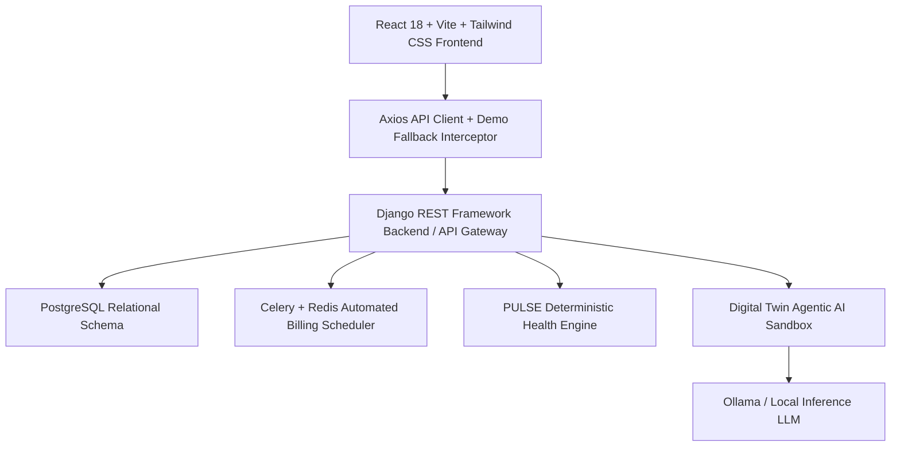

# 🚀 BRIGHTLOOP – Subscription Control Tower
### Intelligent Subscription Management & Revenue Optimization Platform

Brightloop is a production-quality, enterprise-grade subscription management and recurring billing platform built for modern SaaS businesses. It manages the complete subscription lifecycle—from multi-variant catalog definition, bespoke quotations, and contractual activations to automated recurring invoice generation, payment reconciliation, rightsizing intelligence, and AI-driven business simulations.

---

## 🌟 Flagship Innovations

### 1. **FLEXI-BILL – Flexible Micro-Subscriptions & Pay-Per-Use**
- **5 Purchasing Models**:
  - **A. Time-Based Access**: ₹5 for 5 minutes, ₹15 for 1 hour, ₹30 per day.
  - **B. Usage-Based Access**: ₹5 for 5 operations, ₹10 for 10 document extractions.
  - **C. Feature-Based Access**: Unlock isolated tools without subscribing to entire suites.
  - **D. Content-Based Access**: Pay-per-view access with strict viewing and time caps.
  - **E. Hybrid Subscription**: Base recurring tier + on-demand micro-token overages.
- **Prepaid Escrow Wallet**: Concurrency-protected balance, instant top-ups, and immutable transaction logs.
- **Digital Entitlement System**: Dynamic tokens with start, expiry, and real-time usage quotas.
- **Smart Consumption Optimizer**: Side-by-side economics comparing flat plans against consumption patterns with customer consent guarantees.

### 2. **PULSE – Subscription Intelligence**
- **Customer-Side Waste Detector**: Tracks purchased vs. active accounts (e.g. 20 seats paid, 12 active, 8 idle) and proactively proposes rightsizing before renewals.
- **Business-Side Revenue Health Score**: Deterministic 0–100 scoring engine analyzing payment punctuality, renewal stability, feature decay, and pause frequency to categorize accounts into *Healthy*, *Medium Risk*, and *High Risk*.

### 3. **Digital Twin – Agentic AI Simulation Engine**
- **Isolated Simulation Sandbox**: Point-in-time immutable database snapshots of customers, plans, invoices, and payments. Live data is never modified directly.
- **Natural Language What-If Scenarios**:
  - *"What happens if we increase monthly plan prices by 10%?"*
  - *"Which subscriptions are most likely to become overdue next month?"*
  - *"What if all expiring discounts are removed?"*
- **Strict Safety Protocol**: `Understand → Select Tool → Calculate → Explain → Approve → Apply`.
- **Deterministic Python Engine**: Supported by Ollama local inference with mathematical certainty and administrator sign-off.

### 4. **Trust & Immutable Audit Trail**
- High-integrity verifiable audit log recording:
  - User ID and role
  - Action executed (e.g. `DISCOUNT_UPDATED`, `INVOICE_CONFIRMED`)
  - Target entity type and ID
  - Side-by-side JSON state diff (`previous_value` vs. `new_value`)
  - Timestamp and cryptographic session token

---

## 📐 Technology Architecture



---

## 🔑 Demo Access Credentials

The platform features built-in fallback authentication and demo data:

| Portal | Email | Password | Role Permissions |
| :--- | :--- | :--- | :--- |
| **Administrator** | `admin@brightloop.io` | `Password@123` | Full access across all 15 business & AI modules |
| **Internal Staff** | `staff@brightloop.io` | `Password@123` | Restricted operational queue, assigned customers, dunning |
| **Customer Portal**| `customer@brightloop.io`| `Password@123` | Self-service subscriptions, wallet, flexi-store, savings |

---

## 💻 Quick Start & Local Execution

### 1. Clone & Install Dependencies
```bash
cd brightloop-frontend
npm install
```

### 2. Run Local Development Server
```bash
npm run dev
```

Visit **`http://localhost:5173`** in your browser.

### 3. Production Build
```bash
npm run build
npm run preview
```

---

## 📁 Repository Directory Structure

```
brightloop-frontend/
├── index.html
├── package.json
├── vite.config.js
├── tailwind.config.js
├── postcss.config.js
├── public/
│   └── brightloop-icon.svg
└── src/
    ├── api/
    │   ├── client.js
    │   ├── endpoints.js
    │   └── mockData.js
    ├── components/
    │   ├── charts/
    │   ├── common/
    │   └── layout/
    ├── contexts/
    │   ├── AuthContext.jsx
    │   └── ThemeContext.jsx
    ├── hooks/
    │   ├── useApiData.js
    │   └── useFilters.js
    ├── pages/
    │   ├── admin/
    │   │   ├── AdminDashboard.jsx
    │   │   ├── audit/
    │   │   ├── customers/
    │   │   ├── digital-twin/
    │   │   ├── discounts/
    │   │   ├── flexibill/
    │   │   ├── invoices/
    │   │   ├── payments/
    │   │   ├── plans/
    │   │   ├── products/
    │   │   ├── pulse/
    │   │   ├── quotations/
    │   │   ├── settings/
    │   │   ├── staff/
    │   │   ├── subscriptions/
    │   │   └── taxes/
    │   ├── auth/
    │   ├── customer/
    │   │   ├── CustomerDashboard.jsx
    │   │   ├── AccountSettings.jsx
    │   │   ├── flexibill/
    │   │   ├── invoices/
    │   │   ├── payments/
    │   │   ├── subscriptions/
    │   │   └── wallet/
    │   └── staff/
    │       ├── StaffDashboard.jsx
    │       ├── StaffCustomerList.jsx
    │       ├── StaffSubscriptionList.jsx
    │       ├── StaffInvoiceList.jsx
    │       └── StaffOverdueList.jsx
    ├── utils/
    │   ├── constants.js
    │   └── helpers.js
    ├── App.jsx
    ├── main.jsx
    └── index.css
```
